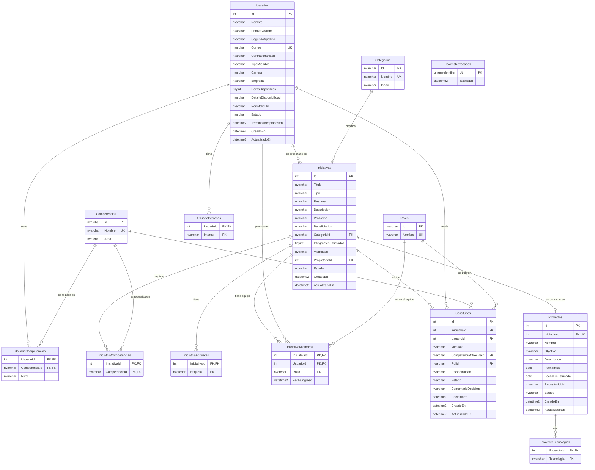
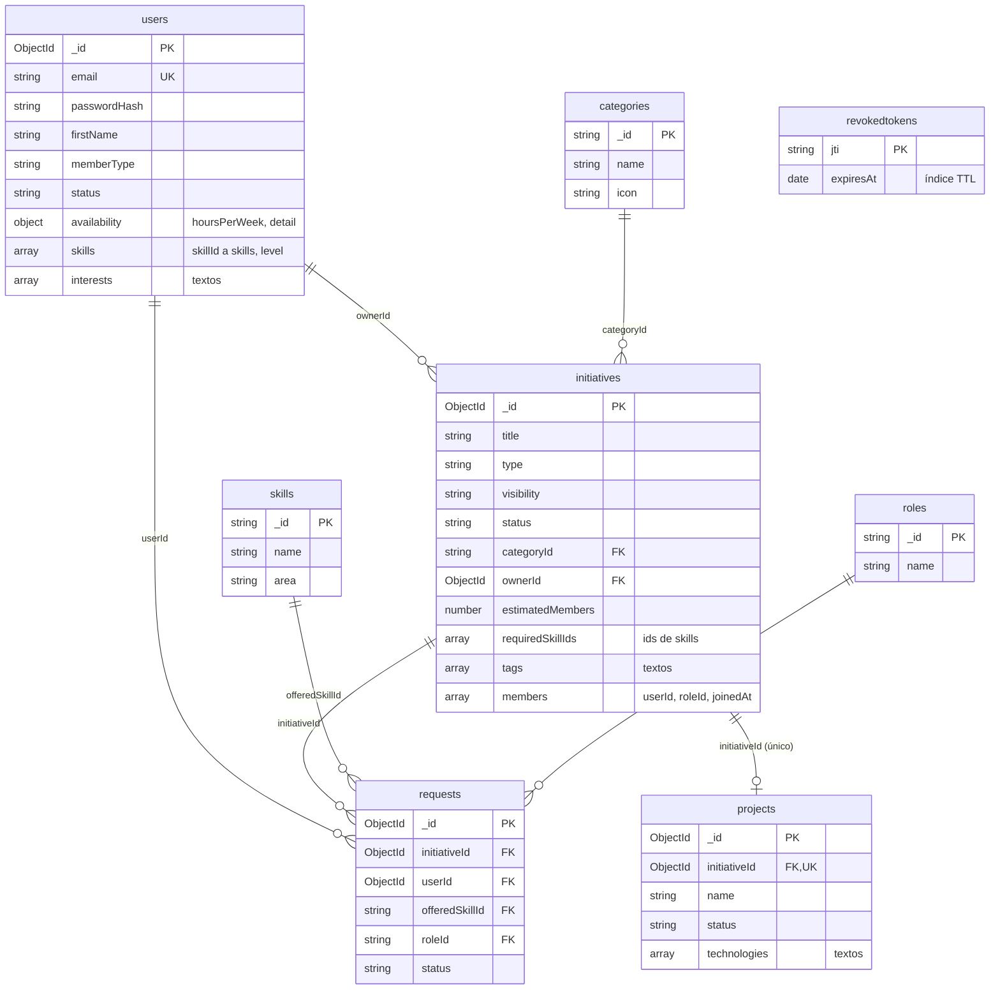

# Innovation Hub · Modelo de datos en SQL Server

Este documento pasa el modelo de MongoDB del Avance 2 a tablas de SQL Server, para implementarlo en la entrega final con Entity Framework Core. Las consultas de ejemplo están en [`consultas.sql`](consultas.sql) y el diseño de dos rutas de lectura en [`rutas.md`](rutas.md).

El modelo de partida, el de MongoDB del Avance 2, está al final, en [Antes: el modelo en MongoDB (Avance 2)](#antes-el-modelo-en-mongodb-avance-2). Ahí se puede comparar cada colección con las tablas que la reemplazan.

**Antes y ahora, en resumen**

| | Antes (MongoDB, Avance 2) | Ahora (SQL Server) |
|---|---|---|
| Unidad de datos | 8 colecciones de documentos | 14 tablas con filas |
| Identificador | `_id` ObjectId de 24 caracteres (texto en los catálogos) | `Id INT IDENTITY` (texto en los catálogos) |
| Listas dentro de un registro | Arreglos embebidos: `skills[]`, `interests[]`, `requiredSkillIds[]`, `tags[]`, `members[]`, `technologies[]` | Una tabla hija o intermedia por arreglo, con una fila por elemento |
| Relación con otro registro | Referencia por `_id` que nadie verifica | Llave foránea: la base impide referencias rotas y decide qué pasa al borrar |
| Reglas en la base | Índices únicos (correo, proyecto por iniciativa) y único parcial (RN-11) | UNIQUE, índice único filtrado, CHECK de los enumerados y PK compuestas (RN-15) |
| Aceptar una solicitud | Dos actualizaciones condicionales y compensación manual | Una transacción |

**Decisiones generales**

- **Nombres de tablas y columnas en español** (`Usuarios`, `PropietarioId`).
- **Los valores de los enumerados quedan en inglés** (`'public'`, `'pending'`, `'idea'`): son los del contrato de la API, que está congelado, y el cliente React envía y recibe esos mismos textos.
- **Las tablas de dominio usan `INT IDENTITY`.** La API los devuelve como texto (`"id": "1"`), como pide el contrato.
- **Los catálogos conservan su id de texto** (`'cat-educacion'`, `'comp-cloud'`, `'rol-frontend'`), porque el cliente ya los usa y así no hay que traducirlos.

## Diagrama



El diagrama está escrito en Mermaid: GitHub lo dibuja directamente al abrir este archivo.

**Cómo leer el diagrama:** `||--o{` significa «uno a muchos», `||--o|` significa «uno a cero o uno», **PK** es la llave primaria, **FK** una llave foránea y **UK** un valor que no se repite. Las tablas con dos `PK` tienen una **llave primaria compuesta**. `TokensRevocados` no se relaciona con ninguna otra tabla: solo guarda los identificadores de los tokens cerrados.

### Relaciones y cómo se resuelven

- **Usuario–competencia:** muchos a muchos. Se resuelve con la tabla intermedia `UsuarioCompetencias (UsuarioId, CompetenciaId)`, que además guarda el `Nivel` de cada competencia.
- **Usuario–iniciativa:** son dos relaciones distintas:
  - **Propietario:** 1 a muchos. Se resuelve con la llave foránea `Iniciativas.PropietarioId → Usuarios`. Cada iniciativa tiene exactamente un dueño (RN-02).
  - **Miembro del equipo:** muchos a muchos. Se resuelve con la tabla intermedia `IniciativaMiembros (IniciativaId, UsuarioId)`, que además guarda `RolId` y `FechaIngreso`.
- **Iniciativa–competencia:** muchos a muchos. Se resuelve con la tabla intermedia `IniciativaCompetencias (IniciativaId, CompetenciaId)`.
- **Iniciativa–solicitud:** 1 a muchos. Se resuelve con la llave foránea `Solicitudes.IniciativaId → Iniciativas`.
- **Proyecto–usuario:** muchos a muchos. Se resuelve con la tabla intermedia `IniciativaMiembros`, a la que el proyecto llega por `Proyectos.IniciativaId`: el equipo del proyecto es el mismo de su iniciativa. El dueño del proyecto es `Iniciativas.PropietarioId`. No se crea una tabla `ProyectoMiembros` para no guardar el mismo equipo dos veces, que es lo mismo que hace hoy la API (`serializarProyecto` toma los miembros de la iniciativa).
- **Proyecto–iniciativa:** 1 a 1, que es un caso especial de 1 a muchos. Se resuelve con la llave foránea `Proyectos.IniciativaId → Iniciativas` marcada **UNIQUE**: una iniciativa genera como máximo un proyecto (RN-18).

**Otras relaciones del modelo:** todas son 1 a muchos y se resuelven con una llave foránea.
- Categoría–iniciativa → `Iniciativas.CategoriaId`.
- Usuario–solicitud → `Solicitudes.UsuarioId`.
- Competencia–solicitud → `Solicitudes.CompetenciaOfrecidaId`.
- Rol–solicitud → `Solicitudes.RolId`.
- Rol–miembro → `IniciativaMiembros.RolId`.
- Usuario–interés → `UsuarioIntereses.UsuarioId`.
- Iniciativa–etiqueta → `IniciativaEtiquetas.IniciativaId`.
- Proyecto–tecnología → `ProyectoTecnologias.ProyectoId`.

### Del documento a la tabla

En una tabla relacional cada celda guarda **un solo valor**: es la primera forma normal. Por eso cada arreglo de MongoDB pasa a una tabla propia, con una fila por elemento. Los objetos que aparecen una sola vez se convierten en columnas.

| En MongoDB (Avance 2) | Quedó en | Por qué |
|---|---|---|
| Colección `users` | `Usuarios` | Cada documento es una fila. `passwordHash` pasa a `ContrasenaHash`, y `email` mantiene su UNIQUE (RN-01) |
| Objeto `users.availability { hoursPerWeek, detail }` | Columnas `Usuarios.HorasDisponibles` y `Usuarios.DetalleDisponibilidad` | No es un arreglo: cada usuario tiene **una sola** disponibilidad, así que bastan dos columnas y no hace falta otra tabla |
| Arreglo `users.skills[] { skillId, level }` | `UsuarioCompetencias` | Es una relación muchos a muchos con el catálogo y además guarda el nivel. Una fila por competencia, y la llave compuesta impide repetirla |
| Arreglo `users.interests[]` | `UsuarioIntereses` | Lista de textos libres sin catálogo. Una fila por interés |
| Colección `categories` | `Categorias` | Catálogo. Conserva el id de texto del contrato (`'cat-educacion'`) |
| Colección `skills` | `Competencias` | Catálogo. Conserva el id de texto (`'comp-cloud'`) |
| Colección `roles` | `Roles` | Catálogo. Conserva el id de texto (`'rol-frontend'`) |
| Colección `initiatives` | `Iniciativas` | Cada documento es una fila. `ownerId` → `PropietarioId` y `categoryId` → `CategoriaId` pasan a ser llaves foráneas |
| Arreglo `initiatives.requiredSkillIds[]` | `IniciativaCompetencias` | Muchos a muchos con el catálogo. En Mongo era un arreglo de referencias; en SQL, una fila por competencia |
| Arreglo `initiatives.tags[]` | `IniciativaEtiquetas` | Textos sin identidad propia. Una fila por etiqueta, que se borra junto con la iniciativa |
| Arreglo `initiatives.members[] { userId, roleId, joinedAt }` | `IniciativaMiembros` | Muchos a muchos entre iniciativas y usuarios, con datos propios: rol y fecha. La llave `(IniciativaId, UsuarioId)` impide que alguien entre dos veces (RN-15). El propietario **no** se inserta aquí (RN-16) |
| Colección `requests` | `Solicitudes` | Ya era una colección con referencias: cada referencia pasa a ser una llave foránea. El índice único parcial pasa a ser un **índice único filtrado** (RN-11) |
| Colección `projects` | `Proyectos` | `initiativeId` único pasa a ser una llave foránea UNIQUE (RN-18). El equipo no se copia: se lee de `IniciativaMiembros` |
| Arreglo `projects.technologies[]` | `ProyectoTecnologias` | Lista de textos. Una fila por tecnología |
| Colección `revokedtokens` | `TokensRevocados` | SQL Server no tiene índices TTL. Una tarea programada borra las filas con `ExpiraEn` vencido, y la verificación del token también ignora las vencidas |

---

## Tablas

**Convenciones:**
- `CreadoEn` y `ActualizadoEn` son `DATETIME2`, obligatorias, con `DEFAULT SYSUTCDATETIME()`. Reemplazan los `timestamps` de Mongoose.
- «Se impide» = `ON DELETE NO ACTION`. «Se borra también» = `ON DELETE CASCADE`. Ninguna llave foránea usa «queda vacío» (`SET NULL`): todas las referencias del modelo son obligatorias.
- Los usuarios **no se borran**: se desactivan con `Estado = 'inactive'`. Por eso todas las llaves foráneas que apuntan a `Usuarios` impiden el borrado.

### Usuarios

| Columna | Tipo | ¿Obligatoria? | Llave | Regla |
|---|---|---|---|---|
| Id | INT IDENTITY | Sí | Primaria | |
| Nombre | NVARCHAR(60) | Sí | | Entre 2 y 60 caracteres |
| PrimerApellido | NVARCHAR(60) | Sí | | Entre 2 y 60 caracteres |
| SegundoApellido | NVARCHAR(60) | No | | Si viene, entre 2 y 60 caracteres |
| Correo | NVARCHAR(120) | Sí | | UNIQUE (no se repite, RN-01). Se guarda en minúsculas |
| ContrasenaHash | NVARCHAR(100) | Sí | | Hash bcrypt, nunca la contraseña. No sale en ninguna respuesta |
| TipoMiembro | NVARCHAR(10) | Sí | | CHECK: `'student'`, `'teacher'` o `'staff'` |
| Carrera | NVARCHAR(60) | Sí | | Entre 2 y 60 caracteres |
| Biografia | NVARCHAR(500) | No | | Hasta 500 caracteres |
| HorasDisponibles | TINYINT | Sí | | DEFAULT 0. CHECK entre 0 y 40 |
| DetalleDisponibilidad | NVARCHAR(100) | No | | Hasta 100 caracteres |
| PortafolioUrl | NVARCHAR(200) | No | | Empieza con `http://` o `https://` |
| Estado | NVARCHAR(10) | Sí | | DEFAULT `'active'`. CHECK: `'active'` o `'inactive'`. Solo un usuario activo inicia sesión o es propietario (RN-03) |
| TerminosAceptadosEn | DATETIME2 | No | | Fecha en que aceptó los términos al registrarse |
| CreadoEn | DATETIME2 | Sí | | DEFAULT `SYSUTCDATETIME()` |
| ActualizadoEn | DATETIME2 | Sí | | DEFAULT `SYSUTCDATETIME()` |

### Categorias

| Columna | Tipo | ¿Obligatoria? | Llave | Regla |
|---|---|---|---|---|
| Id | NVARCHAR(40) | Sí | Primaria | Id de texto del contrato, por ejemplo `'cat-educacion'` |
| Nombre | NVARCHAR(60) | Sí | | UNIQUE (no se repite) |
| Icono | NVARCHAR(40) | No | | Clase de Bootstrap Icons, por ejemplo `'bi-mortarboard'` |

### Competencias

| Columna | Tipo | ¿Obligatoria? | Llave | Regla |
|---|---|---|---|---|
| Id | NVARCHAR(40) | Sí | Primaria | Id de texto, por ejemplo `'comp-cloud'` |
| Nombre | NVARCHAR(60) | Sí | | UNIQUE (no se repite) |
| Area | NVARCHAR(60) | No | | Agrupa las competencias en la interfaz |

### Roles

| Columna | Tipo | ¿Obligatoria? | Llave | Regla |
|---|---|---|---|---|
| Id | NVARCHAR(40) | Sí | Primaria | Id de texto, por ejemplo `'rol-frontend'` |
| Nombre | NVARCHAR(60) | Sí | | UNIQUE (no se repite) |

### UsuarioCompetencias

| Columna | Tipo | ¿Obligatoria? | Llave | Regla |
|---|---|---|---|---|
| UsuarioId | INT | Sí | Primaria (compuesta) · Foránea → Usuarios | Si se borra el usuario, se borra también |
| CompetenciaId | NVARCHAR(40) | Sí | Primaria (compuesta) · Foránea → Competencias | Si se intenta borrar la competencia, se impide |
| Nivel | NVARCHAR(15) | Sí | | CHECK: `'basic'`, `'intermediate'` o `'advanced'` |

La llave `(UsuarioId, CompetenciaId)` impide registrar la misma competencia dos veces. El máximo de 15 por usuario se controla en el servicio.

### UsuarioIntereses

| Columna | Tipo | ¿Obligatoria? | Llave | Regla |
|---|---|---|---|---|
| UsuarioId | INT | Sí | Primaria (compuesta) · Foránea → Usuarios | Si se borra el usuario, se borra también |
| Interes | NVARCHAR(30) | Sí | Primaria (compuesta) | Entre 2 y 30 caracteres. No se repite para el mismo usuario |

El máximo de 10 intereses se controla en el servicio.

### Iniciativas

| Columna | Tipo | ¿Obligatoria? | Llave | Regla |
|---|---|---|---|---|
| Id | INT IDENTITY | Sí | Primaria | |
| Titulo | NVARCHAR(80) | Sí | | Entre 5 y 80 caracteres |
| Tipo | NVARCHAR(10) | Sí | | CHECK: `'idea'`, `'need'` o `'challenge'` (RN-04) |
| Resumen | NVARCHAR(160) | Sí | | Entre 10 y 160 caracteres |
| Descripcion | NVARCHAR(2000) | Sí | | Entre 20 y 2000 caracteres |
| Problema | NVARCHAR(1000) | Sí | | Entre 10 y 1000 caracteres |
| Beneficiarios | NVARCHAR(500) | Sí | | Entre 5 y 500 caracteres |
| CategoriaId | NVARCHAR(40) | Sí | Foránea → Categorias | Si se intenta borrar la categoría, se impide |
| IntegrantesEstimados | TINYINT | Sí | | CHECK entre 1 y 20. Incluye al propietario |
| Visibilidad | NVARCHAR(15) | Sí | | CHECK: `'public'`, `'institutional'`, `'restricted'` o `'private'`. Un solo valor (RN-05) |
| PropietarioId | INT | Sí | Foránea → Usuarios | Exactamente uno (RN-02); sale del token, nunca del cuerpo. Si se intenta borrar el usuario, se impide |
| Estado | NVARCHAR(10) | Sí | | DEFAULT `'published'`. CHECK: `'draft'`, `'published'`, `'forming'`, `'project'` o `'archived'` |
| CreadoEn | DATETIME2 | Sí | | DEFAULT `SYSUTCDATETIME()` |
| ActualizadoEn | DATETIME2 | Sí | | DEFAULT `SYSUTCDATETIME()` |

Índices para el catálogo y los filtros: `(Estado, Tipo, CategoriaId)` y `(PropietarioId)`.

### IniciativaCompetencias

| Columna | Tipo | ¿Obligatoria? | Llave | Regla |
|---|---|---|---|---|
| IniciativaId | INT | Sí | Primaria (compuesta) · Foránea → Iniciativas | Si se borra la iniciativa, se borra también |
| CompetenciaId | NVARCHAR(40) | Sí | Primaria (compuesta) · Foránea → Competencias | Si se intenta borrar la competencia, se impide |

Índice en `(CompetenciaId)` para el filtro «iniciativas que piden esta competencia». Cada iniciativa necesita entre 1 y 8 competencias; ese conteo se controla en el servicio.

### IniciativaEtiquetas

| Columna | Tipo | ¿Obligatoria? | Llave | Regla |
|---|---|---|---|---|
| IniciativaId | INT | Sí | Primaria (compuesta) · Foránea → Iniciativas | Si se borra la iniciativa, se borra también |
| Etiqueta | NVARCHAR(30) | Sí | Primaria (compuesta) | Entre 2 y 30 caracteres: letras, números, espacios o guiones. No se repite en la misma iniciativa |

El máximo de 5 etiquetas se controla en el servicio.

### IniciativaMiembros

| Columna | Tipo | ¿Obligatoria? | Llave | Regla |
|---|---|---|---|---|
| IniciativaId | INT | Sí | Primaria (compuesta) · Foránea → Iniciativas | Si se intenta borrar la iniciativa, se impide (RN-08 y RN-09: con equipo se archiva) |
| UsuarioId | INT | Sí | Primaria (compuesta) · Foránea → Usuarios | Si se intenta borrar el usuario, se impide. La llave compuesta impide entrar dos veces al mismo equipo (RN-15) |
| RolId | NVARCHAR(40) | Sí | Foránea → Roles | Si se intenta borrar el rol, se impide |
| FechaIngreso | DATETIME2 | Sí | | DEFAULT `SYSUTCDATETIME()` |

El propietario **no** se guarda aquí: forma parte del equipo automáticamente (RN-16). Por eso el total de integrantes es la cantidad de filas más uno. El cupo (filas + 1 < `IntegrantesEstimados`) se comprueba dentro de la **transacción** que acepta la solicitud (RN-14).

### Solicitudes

| Columna | Tipo | ¿Obligatoria? | Llave | Regla |
|---|---|---|---|---|
| Id | INT IDENTITY | Sí | Primaria | |
| IniciativaId | INT | Sí | Foránea → Iniciativas | Si se intenta borrar la iniciativa, se impide (RN-09) |
| UsuarioId | INT | Sí | Foránea → Usuarios | El solicitante; sale del token. Si se intenta borrar el usuario, se impide |
| Mensaje | NVARCHAR(300) | Sí | | Entre 15 y 300 caracteres |
| CompetenciaOfrecidaId | NVARCHAR(40) | Sí | Foránea → Competencias | Debe estar en el perfil y ser requerida por la iniciativa (lo revisa el servicio). Si se intenta borrar la competencia, se impide |
| RolId | NVARCHAR(40) | Sí | Foránea → Roles | Si se intenta borrar el rol, se impide |
| Disponibilidad | NVARCHAR(20) | Sí | | Formato `N h/semana`, por ejemplo `'3 h/semana'` |
| Estado | NVARCHAR(10) | Sí | | DEFAULT `'pending'`. CHECK: `'pending'`, `'accepted'`, `'rejected'` o `'cancelled'`. Solo una pendiente se modifica o cancela (RN-12, RN-13) |
| ComentarioDecision | NVARCHAR(300) | No | | Hasta 300 caracteres |
| DecididaEn | DATETIME2 | No | | CHECK: tiene fecha si y solo si `Estado` es `'accepted'` o `'rejected'` |
| CreadoEn | DATETIME2 | Sí | | DEFAULT `SYSUTCDATETIME()` |
| ActualizadoEn | DATETIME2 | Sí | | DEFAULT `SYSUTCDATETIME()` |

**Índice único filtrado** `(IniciativaId, UsuarioId) WHERE Estado = 'pending'`: un usuario no puede tener dos solicitudes pendientes para la misma iniciativa (RN-11), pero sí volver a pedir después de una rechazada o cancelada. Además lleva el índice `(UsuarioId, CreadoEn DESC)` para «mis solicitudes».

### Proyectos

| Columna | Tipo | ¿Obligatoria? | Llave | Regla |
|---|---|---|---|---|
| Id | INT IDENTITY | Sí | Primaria | |
| IniciativaId | INT | Sí | Foránea → Iniciativas | UNIQUE: una iniciativa, un solo proyecto (RN-18). Si se intenta borrar la iniciativa, se impide: se conserva el vínculo con el problema original (RN-19) |
| Nombre | NVARCHAR(80) | Sí | | Entre 5 y 80 caracteres |
| Objetivo | NVARCHAR(300) | Sí | | Entre 10 y 300 caracteres |
| Descripcion | NVARCHAR(2000) | Sí | | Entre 20 y 2000 caracteres |
| FechaInicio | DATE | Sí | | Formato `AAAA-MM-DD` en la API |
| FechaFinEstimada | DATE | No | | CHECK: igual o posterior a `FechaInicio` |
| RepositorioUrl | NVARCHAR(200) | No | | Formato `https://github.com/usuario/repositorio` |
| Estado | NVARCHAR(15) | Sí | | DEFAULT `'planning'`. CHECK: `'planning'`, `'in_progress'`, `'paused'`, `'finished'` o `'archived'` |
| CreadoEn | DATETIME2 | Sí | | DEFAULT `SYSUTCDATETIME()` |
| ActualizadoEn | DATETIME2 | Sí | | DEFAULT `SYSUTCDATETIME()` |

Solo se crea si la iniciativa tiene al menos un miembro además del propietario, es decir, al menos una fila en `IniciativaMiembros` (RN-17). Lo comprueba el servicio dentro de la misma transacción que cambia `Iniciativas.Estado` a `'project'`.

### ProyectoTecnologias

| Columna | Tipo | ¿Obligatoria? | Llave | Regla |
|---|---|---|---|---|
| ProyectoId | INT | Sí | Primaria (compuesta) · Foránea → Proyectos | Si se borra el proyecto, se borra también |
| Tecnologia | NVARCHAR(40) | Sí | Primaria (compuesta) | Entre 1 y 40 caracteres. No se repite en el mismo proyecto |

El máximo de 10 tecnologías se controla en el servicio.

### TokensRevocados

| Columna | Tipo | ¿Obligatoria? | Llave | Regla |
|---|---|---|---|---|
| Jti | UNIQUEIDENTIFIER | Sí | Primaria | El identificador del JWT (`jwtid`, un UUID) que se cerró con logout |
| ExpiraEn | DATETIME2 | Sí | | Cuándo vence el token. Una tarea programada borra las filas vencidas, que reemplaza al índice TTL de MongoDB |

### Reglas que la base no puede garantizar sola

Algunas reglas comparan varias filas o tablas, y un `CHECK` no alcanza. Esas quedan en el **servicio**, dentro de una transacción:

| Regla | Dónde se controla |
|---|---|
| RN-06, RN-07: solo el propietario modifica, elimina o archiva | Servicio: compara `PropietarioId` con el usuario del token |
| RN-10: no solicitar en la propia iniciativa | Servicio (un `CHECK` no puede leer `Iniciativas.PropietarioId` desde `Solicitudes`) |
| RN-14: aceptar incorpora al equipo con control de cupo | Una transacción: `UPDATE Solicitudes … WHERE Estado = 'pending'` + `INSERT IniciativaMiembros` + contar el cupo. Reemplaza la compensación manual de MongoDB |
| RN-16: el propietario no está en `IniciativaMiembros` | Servicio |
| RN-17: proyecto solo con un miembro o más | Servicio, en la transacción de conversión |
| RN-20: visibilidad | Servicio y consultas (`WHERE Visibilidad <> 'private' OR PropietarioId = @usuario OR EXISTS (…IniciativaMiembros…)`) |

## Plan de migración

Son seis pasos para pasar los datos del Innovation Hub de MongoDB (Avance 2) a SQL Server, en este orden.

### Paso 1 · Inventario

Las 8 colecciones del Avance 2, campo por campo. **Clase** dice qué es cada campo:
- **valor**: un dato simple, que pasa a una columna;
- **objeto embebido**: un subdocumento que aparece una sola vez;
- **arreglo embebido**: una lista dentro del documento;
- **referencia → colección**: el `_id` de otro documento.

| Colección | Campo | Tipo en MongoDB | Clase |
|---|---|---|---|
| `users` | `_id` | ObjectId | identificador |
| | `firstName`, `lastName`, `secondLastName`, `email`, `passwordHash`, `memberType`, `career`, `bio`, `portfolioUrl`, `status` | String | valor |
| | `acceptedTermsAt`, `createdAt`, `updatedAt` | Date | valor |
| | `availability { hoursPerWeek, detail }` | objeto | **objeto embebido** |
| | `skills[] { skillId, level }` | arreglo de subdocumentos | **arreglo embebido**; cada `skillId` es una **referencia → `skills`** |
| | `interests[]` | arreglo de String | **arreglo embebido** |
| `categories` | `_id` (texto, `'cat-educacion'`), `name`, `icon` | String | identificador y valores |
| `skills` | `_id` (texto, `'comp-cloud'`), `name`, `area` | String | identificador y valores |
| `roles` | `_id` (texto, `'rol-frontend'`), `name` | String | identificador y valores |
| `initiatives` | `_id` | ObjectId | identificador |
| | `title`, `type`, `summary`, `description`, `problem`, `beneficiaries`, `visibility`, `status` | String | valor |
| | `estimatedMembers` | Number | valor |
| | `createdAt`, `updatedAt` | Date | valor |
| | `categoryId` | String | **referencia → `categories`** |
| | `ownerId` | ObjectId | **referencia → `users`** |
| | `requiredSkillIds[]` | arreglo de String | **arreglo embebido** de **referencias → `skills`** |
| | `tags[]` | arreglo de String | **arreglo embebido** |
| | `members[] { userId, roleId, joinedAt }` | arreglo de subdocumentos | **arreglo embebido**; `userId` es una **referencia → `users`** y `roleId` una **referencia → `roles`** |
| `requests` | `_id` | ObjectId | identificador |
| | `message`, `availability`, `status`, `decisionComment` | String | valor |
| | `decidedAt`, `createdAt`, `updatedAt` | Date | valor |
| | `initiativeId` | ObjectId | **referencia → `initiatives`** |
| | `userId` | ObjectId | **referencia → `users`** |
| | `offeredSkillId` | String | **referencia → `skills`** |
| | `roleId` | String | **referencia → `roles`** |
| `projects` | `_id` | ObjectId | identificador |
| | `name`, `objective`, `description`, `startDate`, `estimatedEndDate`, `repositoryUrl`, `status` | String | valor |
| | `createdAt`, `updatedAt` | Date | valor |
| | `initiativeId` | ObjectId (único) | **referencia → `initiatives`** |
| | `technologies[]` | arreglo de String | **arreglo embebido** |
| `revokedtokens` | `jti` (único), `expiresAt` | String, Date | valores (sin referencias) |

### Paso 2 · Correspondencia

**Cada colección y cada arreglo:** es la tabla «Del documento a la tabla» de la sección [Diagrama](#del-documento-a-la-tabla).

**Cada referencia** pasa a una llave foránea:

| Referencia en MongoDB | Llave foránea en SQL Server |
|---|---|
| `initiatives.ownerId → users` | `Iniciativas.PropietarioId → Usuarios.Id` |
| `initiatives.categoryId → categories` | `Iniciativas.CategoriaId → Categorias.Id` |
| `initiatives.requiredSkillIds[] → skills` | `IniciativaCompetencias.CompetenciaId → Competencias.Id` (y `IniciativaId → Iniciativas`) |
| `initiatives.members[].userId → users` | `IniciativaMiembros.UsuarioId → Usuarios.Id` (y `IniciativaId → Iniciativas`) |
| `initiatives.members[].roleId → roles` | `IniciativaMiembros.RolId → Roles.Id` |
| `users.skills[].skillId → skills` | `UsuarioCompetencias.CompetenciaId → Competencias.Id` (y `UsuarioId → Usuarios`) |
| `requests.initiativeId → initiatives` | `Solicitudes.IniciativaId → Iniciativas.Id` |
| `requests.userId → users` | `Solicitudes.UsuarioId → Usuarios.Id` |
| `requests.offeredSkillId → skills` | `Solicitudes.CompetenciaOfrecidaId → Competencias.Id` |
| `requests.roleId → roles` | `Solicitudes.RolId → Roles.Id` |
| `projects.initiativeId → initiatives` | `Proyectos.IniciativaId → Iniciativas.Id`, con UNIQUE |

Los arreglos de textos sin referencia (`interests[]`, `tags[]`, `technologies[]`) solo tienen la llave foránea hacia su dueño: `UsuarioIntereses.UsuarioId`, `IniciativaEtiquetas.IniciativaId` y `ProyectoTecnologias.ProyectoId`.

### Paso 3 · Orden de creación de las tablas

Una llave foránea solo puede apuntar a una tabla que ya existe. Por eso las tablas se crean por niveles, y los datos se cargan en el mismo orden:

| Nivel | Tablas | Apuntan a |
|---|---|---|
| 1 | `Usuarios`, `Categorias`, `Competencias`, `Roles`, `TokensRevocados` | Nadie |
| 2 | `UsuarioCompetencias`, `UsuarioIntereses`, `Iniciativas` | `Usuarios`, `Competencias`, `Categorias` |
| 3 | `IniciativaCompetencias`, `IniciativaEtiquetas`, `IniciativaMiembros` | `Iniciativas`, `Competencias`, `Usuarios`, `Roles` |
| 4 | `Solicitudes`, `Proyectos` | `Iniciativas`, `Usuarios`, `Competencias`, `Roles` |
| 5 | `ProyectoTecnologias` | `Proyectos` |

Para **borrar** todo, por ejemplo para volver a cargar los datos, el orden es el inverso: del nivel 5 al 1.

### Paso 4 · Identificadores

En MongoDB cada documento tiene un `_id` ObjectId de 24 caracteres. En SQL Server cada fila tendrá un `Id INT IDENTITY` que asigna la base. Las referencias se conservan con una **tabla de equivalencias** que solo existe durante la migración:

```sql
CREATE TABLE #Equivalencias (
    Coleccion NVARCHAR(20) NOT NULL,   -- 'users', 'initiatives', 'requests', 'projects'
    MongoId   CHAR(24)     NOT NULL,   -- el _id original
    SqlId     INT          NOT NULL,   -- el Id nuevo
    PRIMARY KEY (Coleccion, MongoId)
);
```

**Cómo se usa:**
1. Al insertar cada usuario, iniciativa, solicitud o proyecto, se guarda el `Id` que generó la base, por ejemplo con `OUTPUT INSERTED.Id`, junto a su `_id` original.
2. Al insertar una fila que apunta a otra, la referencia se **traduce**: por ejemplo, `members[].userId = 650000000000000000000002` se busca en `#Equivalencias` con `Coleccion = 'users'` y se guarda `UsuarioId = 2`.
3. Por eso el orden del paso 3 es obligatorio: cuando se inserta un hijo, la equivalencia de su padre ya tiene que existir.
4. **Los catálogos no cambian de id.** `'cat-educacion'`, `'comp-cloud'` y `'rol-frontend'` son el mismo texto en las dos bases, así que no necesitan equivalencia.

Con los datos de prueba la equivalencia es directa: el último número del ObjectId pasa a ser el `Id`. Para conservar esos números se cargan con `SET IDENTITY_INSERT <tabla> ON`.

| Colección | `_id` en MongoDB | `Id` en SQL Server | Es |
|---|---|---|---|
| `users` | `650000000000000000000001` | 1 | Leonardo Brenes Arias |
| `users` | `650000000000000000000002` | 2 | Donatello Quirós |
| `users` | `650000000000000000000003` | 3 | Rafael Montero Chaves |
| `users` | `650000000000000000000004` | 4 | Miguel Solano |
| `initiatives` | `660000000000000000000001` | 1 | Plataforma de mentorías de programación |
| `initiatives` | `660000000000000000000002` | 2 | Monitoreo de la red de los laboratorios |
| `initiatives` | `660000000000000000000003` | 3 | Grupos de estudio para certificaciones de seguridad |
| `initiatives` | `660000000000000000000004` | 4 | Galería web de proyectos de graduación |
| `initiatives` | `660000000000000000000005` | 5 | Reducir el tiempo de atención de la mesa de ayuda |
| `initiatives` | `660000000000000000000006` | 6 | Laboratorio de práctica en la nube |
| `initiatives` | `660000000000000000000007` | 7 | Gestor de contraseñas para el grupo de investigación |
| `initiatives` | `660000000000000000000008` | 8 | CTF interuniversitario de ciberseguridad |
| `requests` | `670000000000000000000001` | 1 | Rafael → iniciativa 2 (accepted) |
| `requests` | `670000000000000000000002` | 2 | Miguel → iniciativa 6 (accepted) |
| `requests` | `670000000000000000000003` | 3 | Rafael → iniciativa 1 (pending) |
| `requests` | `670000000000000000000004` | 4 | Leonardo → iniciativa 2 (accepted) |
| `requests` | `670000000000000000000005` | 5 | Rafael → iniciativa 6 (rejected) |
| `projects` | `680000000000000000000001` | 1 | Monitoreo de la red de los laboratorios |

**En la API** el contrato pide los ids como texto, así que .NET responde `"id": "1"` (`Id.ToString()`) y el cliente React no cambia. Lo único que cambia es el valor: una dirección guardada con el ObjectId viejo, como `/iniciativas/660000000000000000000001`, deja de existir. Las pruebas de Postman y Hoppscotch se actualizan cambiando los ids del objeto `ID` en `pruebas/generar-coleccion.mjs`.

### Paso 5 · Carga de datos

Son los mismos datos de prueba de la API (`servidor/src/seed/datos/`), ya traducidos con el paso 4, en el orden del paso 3. La contraseña de los cuatro usuarios es `Prueba123!`; en la tabla se guarda solo su hash bcrypt. La columna **«Se lee como»** no existe en la base: solo explica la fila.

Con estos datos se cubre el mínimo de la consigna: **4 usuarios, 8 competencias, 8 iniciativas con las 4 visibilidades, 5 solicitudes y 1 proyecto**, con todas sus relaciones.

#### Nivel 1

**Usuarios**

| Id | Nombre | PrimerApellido | SegundoApellido | Correo | ContrasenaHash | TipoMiembro | Carrera | HorasDisponibles | DetalleDisponibilidad | PortafolioUrl | Estado | TerminosAceptadosEn | CreadoEn | ActualizadoEn |
|---|---|---|---|---|---|---|---|---|---|---|---|---|---|---|
| 1 | Leonardo | Brenes | Arias | leonardo.brenes@ucenfotec.ac.cr | $2b$10$… (hash de Prueba123!) | student | Ingeniería del Software | 6 | tardes y fines de semana | https://github.com/leonardobrenes | active | 2026-09-01 14:00:00 | 2026-09-01 14:00:00 | 2026-09-20 14:00:00 |
| 2 | Donatello | Quirós | NULL | donatello.quiros@ucenfotec.ac.cr | $2b$10$… (hash de Prueba123!) | teacher | Ciberseguridad | 4 | martes y jueves | NULL | active | 2026-09-01 14:00:00 | 2026-09-01 14:00:00 | 2026-09-01 14:00:00 |
| 3 | Rafael | Montero | Chaves | rafael.montero@ucenfotec.ac.cr | $2b$10$… (hash de Prueba123!) | student | Ingeniería en Ciberseguridad | 3 | mañanas | NULL | active | 2026-09-02 14:00:00 | 2026-09-02 14:00:00 | 2026-09-02 14:00:00 |
| 4 | Miguel | Solano | NULL | miguel.solano@ucenfotec.ac.cr | $2b$10$… (hash de Prueba123!) | staff | Tecnologías de Información | 0 |  | https://github.com/miguelsolano | active | 2026-09-03 14:00:00 | 2026-09-03 14:00:00 | 2026-09-03 14:00:00 |

*Biografía de cada usuario (columna `Biografia` de la misma tabla):*

| Id | Biografia |
|---|---|
| 1 | Cuarto cuatrimestre. Me interesa el desarrollo web y armar comunidades técnicas en Cenfotec. |
| 2 | Docente de redes y seguridad. Busco proyectos aplicados para mis cursos. |
| 3 | Coordino el grupo estudiantil de seguridad informática. |
| 4 |  |

**Categorias**

| Id | Nombre | Icono |
|---|---|---|
| cat-software | Desarrollo de software | bi-code-slash |
| cat-ciberseguridad | Ciberseguridad | bi-shield-lock |
| cat-sistemas | Sistemas e infraestructura | bi-hdd-network |
| cat-diseno | Diseño y experiencia digital | bi-palette |
| cat-educacion | Educación y mentorías | bi-mortarboard |
| cat-emprendimiento | Emprendimiento tecnológico | bi-rocket-takeoff |
| cat-impacto-social | Impacto social | bi-people |
| cat-otro | Otro | bi-three-dots |

**Competencias**

| Id | Nombre | Area |
|---|---|---|
| comp-desarrollo-web | Desarrollo web (JavaScript y React) | Desarrollo |
| comp-diseno-ux | Diseño UX/UI | Diseño |
| comp-diseno-grafico | Diseño gráfico y multimedia | Diseño |
| comp-analisis-datos | Análisis de datos | Datos |
| comp-gestion-agil | Gestión ágil (Scrum) | Gestión |
| comp-redes | Redes y sistemas operativos | Infraestructura |
| comp-cloud | Cloud y DevOps | Infraestructura |
| comp-ciberseguridad | Ciberseguridad y hacking ético | Seguridad |

**Roles**

| Id | Nombre |
|---|---|
| rol-frontend | Desarrollo frontend |
| rol-backend | Desarrollo backend |
| rol-ux | Diseño UX/UI |
| rol-datos | Análisis de datos |
| rol-coordinacion | Scrum Master / coordinación |
| rol-comunicacion | Documentación y difusión |
| rol-investigacion | Investigación |
| rol-infraestructura | Infraestructura y seguridad |

**TokensRevocados**: sin filas. Se llena solo cuando alguien cierra sesión.

#### Nivel 2

**UsuarioCompetencias** (qué competencias tiene cada usuario)

| UsuarioId | CompetenciaId | Nivel | Se lee como |
|---|---|---|---|
| 1 | comp-desarrollo-web | advanced | Leonardo Brenes Arias · Desarrollo web (JavaScript y React) · advanced |
| 1 | comp-gestion-agil | intermediate | Leonardo Brenes Arias · Gestión ágil (Scrum) · intermediate |
| 2 | comp-analisis-datos | advanced | Donatello Quirós · Análisis de datos · advanced |
| 2 | comp-redes | advanced | Donatello Quirós · Redes y sistemas operativos · advanced |
| 3 | comp-gestion-agil | intermediate | Rafael Montero Chaves · Gestión ágil (Scrum) · intermediate |
| 3 | comp-ciberseguridad | advanced | Rafael Montero Chaves · Ciberseguridad y hacking ético · advanced |
| 3 | comp-analisis-datos | basic | Rafael Montero Chaves · Análisis de datos · basic |
| 4 | comp-cloud | advanced | Miguel Solano · Cloud y DevOps · advanced |
| 4 | comp-diseno-ux | basic | Miguel Solano · Diseño UX/UI · basic |

**UsuarioIntereses**

| UsuarioId | Interes | Se lee como |
|---|---|---|
| 1 | software | Leonardo se interesa en software |
| 1 | mentorías | Leonardo se interesa en mentorías |
| 2 | redes | Donatello se interesa en redes |
| 2 | monitoreo | Donatello se interesa en monitoreo |
| 3 | hacking ético | Rafael se interesa en hacking ético |
| 3 | certificaciones | Rafael se interesa en certificaciones |
| 4 | infraestructura | Miguel se interesa en infraestructura |

**Iniciativas**

| Id | Titulo | Tipo | CategoriaId | IntegrantesEstimados | Visibilidad | PropietarioId | Estado | CreadoEn | ActualizadoEn |
|---|---|---|---|---|---|---|---|---|---|
| 1 | Plataforma de mentorías de programación | idea | cat-educacion | 4 | public | 1 (Leonardo) | forming | 2026-09-08 15:00:00 | 2026-09-20 15:00:00 |
| 2 | Monitoreo de la red de los laboratorios | challenge | cat-sistemas | 3 | public | 2 (Donatello) | project | 2026-08-30 15:00:00 | 2026-09-20 15:00:00 |
| 3 | Grupos de estudio para certificaciones de seguridad | need | cat-ciberseguridad | 5 | institutional | 3 (Rafael) | published | 2026-09-10 15:00:00 | 2026-09-10 15:00:00 |
| 4 | Galería web de proyectos de graduación | idea | cat-diseno | 3 | public | 1 (Leonardo) | published | 2026-09-14 15:00:00 | 2026-09-14 15:00:00 |
| 5 | Reducir el tiempo de atención de la mesa de ayuda | challenge | cat-sistemas | 2 | restricted | 4 (Miguel) | published | 2026-09-12 15:00:00 | 2026-09-18 15:00:00 |
| 6 | Laboratorio de práctica en la nube | need | cat-sistemas | 6 | public | 2 (Donatello) | forming | 2026-09-05 15:00:00 | 2026-09-13 15:00:00 |
| 7 | Gestor de contraseñas para el grupo de investigación | idea | cat-ciberseguridad | 3 | private | 3 (Rafael) | forming | 2026-09-16 15:00:00 | 2026-09-19 15:00:00 |
| 8 | CTF interuniversitario de ciberseguridad | challenge | cat-ciberseguridad | 4 | public | 4 (Miguel) | published | 2026-09-21 15:00:00 | 2026-09-21 15:00:00 |

*Columnas de texto de cada iniciativa (misma tabla):*

| Id | Resumen | Descripcion | Problema | Beneficiarios |
|---|---|---|---|---|
| 1 | Conectar estudiantes avanzados de software con quienes empiezan a programar. | Hoy las mentorías se coordinan por chat y dependen de conocidos. Proponemos una plataforma para publicar horarios, emparejar mentores por tecnología y registrar las sesiones. | Los estudiantes de primer ingreso no saben a quién pedir ayuda fuera de clase. | Estudiantes de primer ingreso de las carreras de software. |
| 2 | Tablero en tiempo real del tráfico y la disponibilidad de la red de los laboratorios. | Cuando la red de un laboratorio se satura o se cae, el área de TI se entera por los estudiantes. Se busca un sistema de monitoreo con alertas tempranas. | Caídas y saturación de la red sin datos para prevenirlas. | Estudiantes, docentes y el área de TI. |
| 3 | Preparación entre pares para Security+, CCNA y CEH. | Muchos estudiantes quieren certificarse, pero estudian solos y abandonan. Se busca organizar grupos semanales con simulacros y laboratorios prácticos. | Baja tasa de aprobación de certificaciones por falta de acompañamiento. | Estudiantes de Ciberseguridad y de Redes. |
| 4 | Un sitio para mostrar los proyectos finales de todas las carreras de Cenfotec. | Los proyectos de graduación se presentan una vez y se pierden. Proponemos una galería pública con capturas, video y enlace al repositorio de cada proyecto. | El trabajo de los estudiantes no queda visible para empresas ni para nuevas generaciones. | Estudiantes que buscan empleo y futuros estudiantes. |
| 5 | Optimizar el proceso de tiquetes de soporte técnico del campus. | El tiempo promedio de resolución de un tiquete supera las 48 horas. Se busca analizar los tiquetes históricos para clasificar y priorizar mejor. | Insatisfacción de estudiantes y docentes por demoras en soporte técnico. | Personal administrativo, docentes y estudiantes. |
| 6 | Un entorno compartido en la nube para practicar DevOps sin costo. | Los cursos de infraestructura necesitan servidores para practicar despliegues, pero cada estudiante paga su propia cuenta. Se busca un laboratorio común con cuotas y plantillas listas. | Practicar en la nube es caro y cada curso arma su entorno desde cero. | Estudiantes de Sistemas, Redes y Desarrollo de Software. |
| 7 | Herramienta privada para compartir credenciales del laboratorio de forma segura. | Las credenciales de los equipos del laboratorio se comparten por chat. Se propone un gestor cifrado con permisos por persona y registro de accesos. | Credenciales compartidas sin control ni trazabilidad. | Integrantes del grupo de investigación en seguridad. |
| 8 | Organizar una competencia Capture the Flag abierta a otras universidades. | Los estudiantes practican retos de seguridad por su cuenta. Se busca organizar un CTF anual con retos propios, tabla de posiciones e identidad visual del evento. | No hay un espacio para que los estudiantes midan sus habilidades de seguridad con otras universidades. | Estudiantes de Ciberseguridad y comunidad técnica universitaria. |

#### Nivel 3

**IniciativaCompetencias** (qué competencias requiere cada iniciativa)

| IniciativaId | CompetenciaId | Se lee como |
|---|---|---|
| 1 | comp-desarrollo-web | Plataforma de mentorías de programación requiere Desarrollo web (JavaScript y React) |
| 1 | comp-diseno-ux | Plataforma de mentorías de programación requiere Diseño UX/UI |
| 1 | comp-gestion-agil | Plataforma de mentorías de programación requiere Gestión ágil (Scrum) |
| 2 | comp-analisis-datos | Monitoreo de la red de los laboratorios requiere Análisis de datos |
| 2 | comp-redes | Monitoreo de la red de los laboratorios requiere Redes y sistemas operativos |
| 2 | comp-desarrollo-web | Monitoreo de la red de los laboratorios requiere Desarrollo web (JavaScript y React) |
| 3 | comp-gestion-agil | Grupos de estudio para certificaciones de seguridad requiere Gestión ágil (Scrum) |
| 3 | comp-ciberseguridad | Grupos de estudio para certificaciones de seguridad requiere Ciberseguridad y hacking ético |
| 4 | comp-desarrollo-web | Galería web de proyectos de graduación requiere Desarrollo web (JavaScript y React) |
| 4 | comp-diseno-grafico | Galería web de proyectos de graduación requiere Diseño gráfico y multimedia |
| 5 | comp-analisis-datos | Reducir el tiempo de atención de la mesa de ayuda requiere Análisis de datos |
| 6 | comp-gestion-agil | Laboratorio de práctica en la nube requiere Gestión ágil (Scrum) |
| 6 | comp-cloud | Laboratorio de práctica en la nube requiere Cloud y DevOps |
| 7 | comp-diseno-ux | Gestor de contraseñas para el grupo de investigación requiere Diseño UX/UI |
| 7 | comp-desarrollo-web | Gestor de contraseñas para el grupo de investigación requiere Desarrollo web (JavaScript y React) |
| 8 | comp-ciberseguridad | CTF interuniversitario de ciberseguridad requiere Ciberseguridad y hacking ético |
| 8 | comp-diseno-grafico | CTF interuniversitario de ciberseguridad requiere Diseño gráfico y multimedia |
| 8 | comp-gestion-agil | CTF interuniversitario de ciberseguridad requiere Gestión ágil (Scrum) |

**IniciativaEtiquetas**

| IniciativaId | Etiqueta |
|---|---|
| 1 | mentorías |
| 1 | programación |
| 2 | redes |
| 2 | monitoreo |
| 3 | certificaciones |
| 3 | tutorías |
| 4 | portafolio |
| 4 | graduación |
| 5 | soporte |
| 5 | procesos |
| 6 | cloud |
| 6 | devops |
| 7 | seguridad |
| 7 | contraseñas |
| 8 | ctf |
| 8 | competencia |
| 8 | evento |

**IniciativaMiembros** (quién está en cada equipo, además del propietario)

| IniciativaId | UsuarioId | RolId | FechaIngreso | Se lee como |
|---|---|---|---|---|
| 1 | 2 | rol-backend | 2026-09-12 15:00:00 | Donatello Quirós está en «Plataforma de mentorías de programación» como Desarrollo backend |
| 2 | 1 | rol-frontend | 2026-09-11 15:00:00 | Leonardo Brenes Arias está en «Monitoreo de la red de los laboratorios» como Desarrollo frontend |
| 2 | 3 | rol-datos | 2026-09-11 15:00:00 | Rafael Montero Chaves está en «Monitoreo de la red de los laboratorios» como Análisis de datos |
| 6 | 4 | rol-infraestructura | 2026-09-13 15:00:00 | Miguel Solano está en «Laboratorio de práctica en la nube» como Infraestructura y seguridad |
| 7 | 1 | rol-frontend | 2026-09-17 15:00:00 | Leonardo Brenes Arias está en «Gestor de contraseñas para el grupo de investigación» como Desarrollo frontend |

Con el propietario, los equipos completos quedan así: 1 = Leonardo + Donatello; 2 = Donatello + Leonardo + Rafael; 3 = Rafael; 4 = Leonardo; 5 = Miguel; 6 = Donatello + Miguel; 7 = Rafael + Leonardo; 8 = Miguel.


#### Nivel 4

**Solicitudes**

| Id | IniciativaId | UsuarioId | CompetenciaOfrecidaId | RolId | Disponibilidad | Estado | DecididaEn | CreadoEn | ActualizadoEn | Se lee como |
|---|---|---|---|---|---|---|---|---|---|---|
| 1 | 2 | 3 | comp-analisis-datos | rol-datos | 6 h/semana | accepted | 2026-09-11 15:00:00 | 2026-09-10 15:00:00 | 2026-09-11 15:00:00 | Rafael pide entrar a la 2: accepted |
| 2 | 6 | 4 | comp-cloud | rol-infraestructura | 4 h/semana | accepted | 2026-09-13 15:00:00 | 2026-09-12 15:00:00 | 2026-09-13 15:00:00 | Miguel pide entrar a la 6: accepted |
| 3 | 1 | 3 | comp-gestion-agil | rol-coordinacion | 3 h/semana | pending | NULL | 2026-09-16 15:00:00 | 2026-09-16 15:00:00 | Rafael pide entrar a la 1: pending |
| 4 | 2 | 1 | comp-desarrollo-web | rol-frontend | 5 h/semana | accepted | 2026-09-11 15:00:00 | 2026-09-10 16:00:00 | 2026-09-11 15:00:00 | Leonardo pide entrar a la 2: accepted |
| 5 | 6 | 3 | comp-gestion-agil | rol-coordinacion | 3 h/semana | rejected | 2026-09-15 15:00:00 | 2026-09-14 15:00:00 | 2026-09-15 15:00:00 | Rafael pide entrar a la 6: rejected |

*Columnas de texto de cada solicitud:*

| Id | Mensaje | ComentarioDecision |
|---|---|---|
| 1 | Puedo analizar los registros de tráfico y detectar patrones de saturación. | Bienvenido al equipo. |
| 2 | Administro servidores del campus y puedo preparar las plantillas de despliegue. | NULL |
| 3 | Me gustaría coordinar los sprints y la asignación de mentores. | NULL |
| 4 | Puedo construir el tablero web con React. | NULL |
| 5 | Quisiera coordinar el uso del laboratorio entre los cursos. | Por ahora ya cubrimos la coordinación. |

**Proyectos**

| Id | IniciativaId | Nombre | FechaInicio | FechaFinEstimada | RepositorioUrl | Estado | CreadoEn | ActualizadoEn |
|---|---|---|---|---|---|---|---|---|
| 1 | 2 (Monitoreo de la red de los laboratorios) | Monitoreo de la red de los laboratorios | 2026-09-20 | 2026-12-15 | https://github.com/twbs/bootstrap | in_progress | 2026-09-20 15:00:00 | 2026-09-20 15:00:00 |

*Columnas de texto del proyecto:*

| Id | Objetivo | Descripcion |
|---|---|---|
| 1 | Detectar caídas y saturación de la red de los laboratorios en menos de 5 minutos. | Agentes ligeros en cada laboratorio, tablero web en tiempo real y alertas por correo cuando un enlace se satura o se cae. |

El equipo del proyecto 1 no se copia: es el de la iniciativa 2 en `IniciativaMiembros` (Leonardo y Rafael), más su propietario Donatello.

#### Nivel 5

**ProyectoTecnologias**

| ProyectoId | Tecnologia |
|---|---|
| 1 | Node.js |
| 1 | Prometheus |
| 1 | Grafana |

### Paso 6 · Verificación

**1. Contar.** Cada tabla debe tener tantas filas como documentos, o elementos de arreglo, había en MongoDB. Para las tablas que salen de un arreglo, se cuenta con `$unwind`, que produce un documento por elemento:

| Tabla | Filas esperadas | Sale de | En MongoDB | En SQL Server |
|---|---|---|---|---|
| `Usuarios` | **4** | documentos de `users` | `db.users.countDocuments()` | `SELECT COUNT(*) FROM Usuarios;` |
| `Categorias` | **8** | documentos de `categories` | `db.categories.countDocuments()` | `SELECT COUNT(*) FROM Categorias;` |
| `Competencias` | **8** | documentos de `skills` | `db.skills.countDocuments()` | `SELECT COUNT(*) FROM Competencias;` |
| `Roles` | **8** | documentos de `roles` | `db.roles.countDocuments()` | `SELECT COUNT(*) FROM Roles;` |
| `UsuarioCompetencias` | **9** | suma de `users.skills[]` | `db.users.aggregate([{ $unwind: "$skills" }, { $count: "n" }])` | `SELECT COUNT(*) FROM UsuarioCompetencias;` |
| `UsuarioIntereses` | **7** | suma de `users.interests[]` | `db.users.aggregate([{ $unwind: "$interests" }, { $count: "n" }])` | `SELECT COUNT(*) FROM UsuarioIntereses;` |
| `Iniciativas` | **8** | documentos de `initiatives` | `db.initiatives.countDocuments()` | `SELECT COUNT(*) FROM Iniciativas;` |
| `IniciativaCompetencias` | **18** | suma de `initiatives.requiredSkillIds[]` | `db.initiatives.aggregate([{ $unwind: "$requiredSkillIds" }, { $count: "n" }])` | `SELECT COUNT(*) FROM IniciativaCompetencias;` |
| `IniciativaEtiquetas` | **17** | suma de `initiatives.tags[]` | `db.initiatives.aggregate([{ $unwind: "$tags" }, { $count: "n" }])` | `SELECT COUNT(*) FROM IniciativaEtiquetas;` |
| `IniciativaMiembros` | **5** | suma de `initiatives.members[]` | `db.initiatives.aggregate([{ $unwind: "$members" }, { $count: "n" }])` | `SELECT COUNT(*) FROM IniciativaMiembros;` |
| `Solicitudes` | **5** | documentos de `requests` | `db.requests.countDocuments()` | `SELECT COUNT(*) FROM Solicitudes;` |
| `Proyectos` | **1** | documentos de `projects` | `db.projects.countDocuments()` | `SELECT COUNT(*) FROM Proyectos;` |
| `ProyectoTecnologias` | **3** | suma de `projects.technologies[]` | `db.projects.aggregate([{ $unwind: "$technologies" }, { $count: "n" }])` | `SELECT COUNT(*) FROM ProyectoTecnologias;` |
| `TokensRevocados` | **0** | documentos de `revokedtokens` (el seed los borra) | `db.revokedtokens.countDocuments()` | `SELECT COUNT(*) FROM TokensRevocados;` |

**2. Revisar que las relaciones sigan iguales**, no solo los totales:
- **Equipo por iniciativa:** `SELECT IniciativaId, COUNT(*) FROM IniciativaMiembros GROUP BY IniciativaId` debe coincidir con el tamaño de `members[]` de cada iniciativa: 1, 2, 1 y 1 filas para las iniciativas 1, 2, 6 y 7. Las demás no tienen miembros además del propietario.
- **Referencias sin pareja:** con las llaves foráneas activas no puede haber hijos huérfanos. Si alguna referencia de MongoDB apuntaba a un documento que ya no existía, el `INSERT` falla con el error 547 y se detecta durante la carga, no después.
- **Reglas de negocio:** `SELECT IniciativaId, UsuarioId FROM Solicitudes WHERE Estado = 'pending' GROUP BY IniciativaId, UsuarioId HAVING COUNT(*) > 1` debe devolver **0 filas** (RN-11).

**3. Comparar las respuestas de la API.** Con los mismos datos, `GET /api/initiatives/1` y `GET /api/initiatives?category=cat-sistemas` del servidor Express y del servidor .NET deben devolver el mismo JSON, salvo el valor de los ids (ver `rutas.md`). Al final se corre la colección de Postman contra .NET, con los ids actualizados como dice el paso 4.

---

## Antes: el modelo en MongoDB (Avance 2)

Así estaba guardado el Innovation Hub hasta el Avance 2. Esta sección conserva el diseño original para comparar. La columna **«En SQL Server»** indica a dónde pasó cada parte. El documento tal como se entregó se puede ver en el historial con `git show entrega-2:docs/modelo-datos.md`.

Base: `innovation_hub`. Las colecciones de dominio usan `_id` ObjectId; los catálogos usan `_id` de texto.

### Diagrama de las colecciones

En MongoDB no hay llaves foráneas: las flechas son **referencias** por `_id`, y los arreglos viven **dentro** del documento.



### Colecciones

| Colección | Campos principales | En SQL Server |
|---|---|---|
| `categories` | `_id` (string), `name`, `icon` | `Categorias` |
| `skills` | `_id` (string), `name`, `area` | `Competencias` |
| `roles` | `_id` (string), `name` | `Roles` |
| `users` | `firstName`, `lastName`, `secondLastName`, `email` (único), `passwordHash` (`select: false`), `memberType`, `career`, `bio`, `skills[] { skillId → skills, level }`, `interests[]`, `availability { hoursPerWeek, detail }`, `portfolioUrl`, `status`, `acceptedTermsAt`, `createdAt`, `updatedAt` | `Usuarios`, `UsuarioCompetencias`, `UsuarioIntereses` |
| `initiatives` | `title`, `type`, `summary`, `description`, `problem`, `beneficiaries`, `categoryId → categories`, `requiredSkillIds[] → skills`, `estimatedMembers`, `visibility`, `tags[]`, `ownerId → users`, `members[] { userId → users, roleId → roles, joinedAt }`, `status`, `createdAt`, `updatedAt` | `Iniciativas`, `IniciativaCompetencias`, `IniciativaEtiquetas`, `IniciativaMiembros` |
| `requests` | `initiativeId → initiatives`, `userId → users`, `message`, `offeredSkillId → skills`, `roleId → roles`, `availability`, `status`, `decisionComment`, `decidedAt`, `createdAt`, `updatedAt` | `Solicitudes` |
| `projects` | `initiativeId → initiatives` (único), `name`, `objective`, `description`, `technologies[]`, `startDate`, `estimatedEndDate`, `repositoryUrl`, `status`, `createdAt`, `updatedAt` | `Proyectos`, `ProyectoTecnologias` |
| `revokedtokens` | `jti` (único), `expiresAt` (índice TTL) | `TokensRevocados` |

### Decisiones de embebido o referencia

| Relación | Decisión en MongoDB | Por qué | En SQL Server |
|---|---|---|---|
| Usuario → competencias | **Embebido** `{ skillId, level }` con **referencia** al catálogo | Pocas por usuario, siempre se leen y editan con el perfil; el nombre vive en el catálogo para no duplicarlo | Tabla intermedia `UsuarioCompetencias (UsuarioId, CompetenciaId, Nivel)` |
| Iniciativa → competencias requeridas | **Arreglo de referencias** | Relación muchos a muchos con un catálogo estable; se filtra por `requiredSkillIds` | Tabla intermedia `IniciativaCompetencias (IniciativaId, CompetenciaId)` |
| Iniciativa → etiquetas | **Embebido** como textos | No tienen identidad propia ni se consultan aparte | Tabla hija `IniciativaEtiquetas (IniciativaId, Etiqueta)` |
| Iniciativa → propietario | **Referencia** `ownerId` | El usuario existe por sí mismo y cambia su perfil | Llave foránea `Iniciativas.PropietarioId → Usuarios` |
| Iniciativa → equipo | **Embebido** `members[]` | Acotado (máximo 20), siempre se muestra con la iniciativa, y agregar un miembro con control de cupo es una sola actualización atómica del documento | Tabla intermedia `IniciativaMiembros (IniciativaId, UsuarioId, RolId, FechaIngreso)` |
| Solicitudes | **Colección propia con referencias** | Crece sin límite, se consulta por solicitante y por propietario con filtros y paginación, y tiene ciclo de vida propio | `Solicitudes`, con llaves foráneas a iniciativa, usuario, competencia y rol |
| Proyecto → iniciativa | **Colección propia**, `initiativeId` único | Relación 1 a 1 (RN-18) con estado y datos propios; la iniciativa se conserva (RN-19) | `Proyectos` con `IniciativaId` UNIQUE |
| Logout | **Colección `revokedtokens`** con TTL | MongoDB borra solo las entradas vencidas | `TokensRevocados` con limpieza programada |

Lo único que se repetía era el nombre de la persona en las respuestas: no se guardaba copiado, se resolvía al serializar. En SQL Server se resuelve igual, con un JOIN a `Usuarios`.

### Índices

| Colección | Índice en MongoDB | Para qué | En SQL Server |
|---|---|---|---|
| `users` | `{ email: 1 }` único | RN-01 | UNIQUE en `Usuarios.Correo` |
| `initiatives` | `{ status: 1, type: 1, categoryId: 1 }` | Filtros del catálogo | Índice `(Estado, Tipo, CategoriaId)` |
| `initiatives` | `{ ownerId: 1 }`, `{ 'members.userId': 1 }`, `{ requiredSkillIds: 1 }` | «Mis iniciativas», «participo en», filtro por competencia | Índice en `Iniciativas.PropietarioId`, más las PK de `IniciativaMiembros` e `IniciativaCompetencias` y el índice en `IniciativaCompetencias.CompetenciaId` |
| `requests` | `{ initiativeId: 1, userId: 1 }` único parcial donde `status = 'pending'` | RN-11 garantizada por la base | Índice único **filtrado** `(IniciativaId, UsuarioId) WHERE Estado = 'pending'` |
| `requests` | `{ userId: 1, createdAt: -1 }` | Mis solicitudes | Índice `(UsuarioId, CreadoEn DESC)` |
| `projects` | `{ initiativeId: 1 }` único | RN-18 | UNIQUE en `Proyectos.IniciativaId` |
| `revokedtokens` | `{ expiresAt: 1 }` con `expireAfterSeconds: 0` | Limpieza automática | No hay TTL: una tarea programada borra las filas vencidas |

La búsqueda por texto usaba expresiones regulares sin distinguir mayúsculas sobre título, resumen y etiquetas, para encontrar fragmentos de palabras (el índice de texto de MongoDB solo encuentra palabras completas). En SQL Server se resuelve con `LIKE '%texto%'`, y la intercalación `_CI_` (sin distinguir mayúsculas) de la base cumple ese mismo papel.

### Atomicidad

La aceptación de una solicitud tocaba dos documentos. En lugar de una transacción, se resolvía con actualizaciones condicionales y compensación, que funciona igual con MongoDB local (servidor único, sin transacciones) y con Atlas:

1. `requests.updateOne({ _id, status: 'pending' }, { status: 'accepted', … })`: si no modifica nada, la solicitud ya no estaba pendiente → 409.
2. `initiatives.updateOne({ _id, status ∈ [published, forming], 'members.userId' ≠ usuario, cupo disponible }, { $push: members, status: 'forming' })`.
3. Si el paso 2 no modifica nada, se revierte el paso 1 y se responde 409.

**En SQL Server** es una sola transacción: el `UPDATE` de `Solicitudes` con `WHERE Estado = 'pending'` y el `INSERT` en `IniciativaMiembros` con el control de cupo. Si cualquiera de los dos falla, `ROLLBACK` deshace los dos, sin compensación manual. Está escrita en `consultas.sql`, consulta 4.
